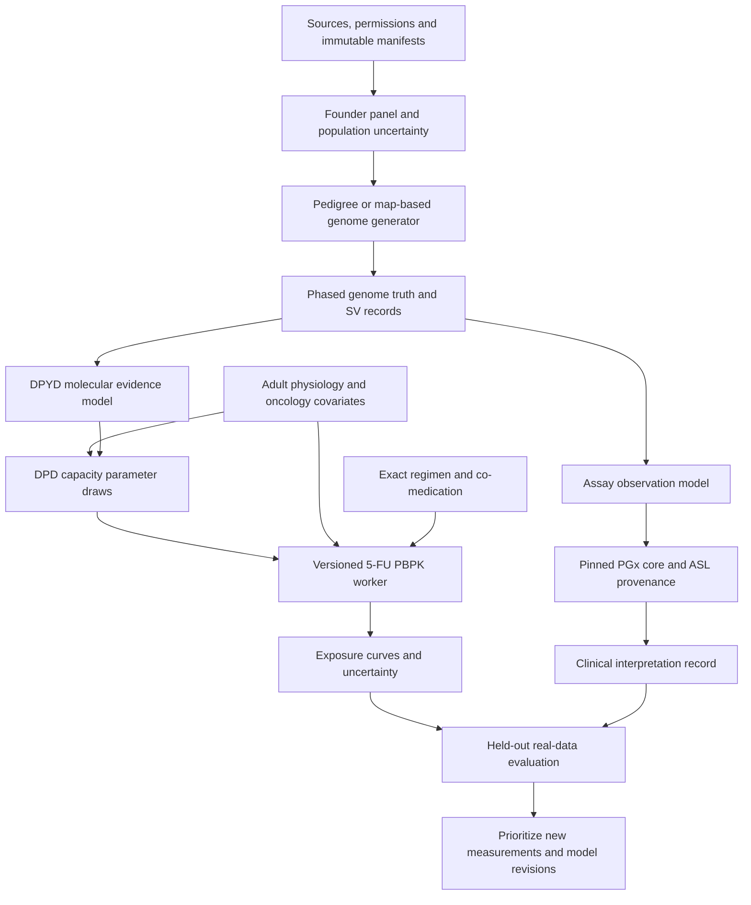

# Implementation plan: Anukriti synthetic patients for DPYD/DPD/5-FU

**Status: detailed plan, not an implemented clinical engine. Research completed
6 September 2026.** The earlier regional generator is archived under
[benchmark](benchmark/README.md). The user requested planning first and then
sequential implementation. This document is the execution order for those
future steps.

**Execution update, 6 September 2026:** Phase 0 has started. See the
[qualification report](phase0/QUALIFICATION_REPORT.md) for completed source checks,
runtime results and unresolved gates. The first published reproduction uses
Grem 2001's 72-hour constant infusion; the 46-hour oncology pilot below remains
a separate proposed study.

## Outcome and first scope

Build an engine that generates source-traceable virtual patients with inherited
genomes, plausible adult physiology, and drug-specific exposure simulations.
Its first pathway is **host germline DPYD → DPD function → systemic 5-FU
exposure**, developed with oncology collaborators. Evaluate usefulness on real
held-out measurements before adding a clinical toxicity model.

Planning default: adult IV infusional 5-FU, with a configurable 46-hour regimen
as the first candidate. The clinical partners' actual regimen, population and
measurement availability determine the final study configuration. Bolus 5-FU,
96/120-hour infusions, oral capecitabine, pediatric physiology and tumor response
are separate model/validation extensions. The founder layer remains reusable
for Bhutan and other small populations; the first evaluation population should
be the oncology population for which real partner data can be obtained.

The engine should produce three kinds of artifact, each explicitly labeled:

1. **Genetic truth cohorts:** phased genomes, structural events, pedigrees,
   ancestry segments and corresponding simulated assay observations.
2. **Virtual exposure cohorts:** physiology and DPD parameter draws, exact
   treatment schedules, concentration-time profiles and exposure uncertainty.
3. **Evaluation reports:** performance against real observations, baselines,
   subgroup behavior, unsupported cases and remaining uncertainty.

Synthetic toxicity labels are not part of the first deliverable. A published
genome generator, a molecular assay and a PBPK model are individually useful;
their composition must be evaluated as a new model.

## Read these companion documents

- [Component research](COMPONENT_RESEARCH.md): evidence and implementation choices.
- [Evidence register](EVIDENCE_REGISTER.md): papers, verified documentation and
  candidate API signatures; source IDs such as G02/P01 refer to that table.
- [Data contracts](DATA_CONTRACTS.md): proposed records, units and lineage.
- [Validation protocol](VALIDATION_PROTOCOL.md): gate definitions and leakage checks.
- [Paper collection](../../papers/synthetic-patients/README.md): requested papers,
  downloadable copies where permitted, and primary links.

## Architecture and ownership



The clinical interpretation record is separate from the quantitative DPD model.
The core's activity score is not passed directly as a clearance fraction. The
scientific model can compare functional hypotheses, while guideline outputs
remain attributed to their pinned source.

### Repository integration

Propose a new Python package/repository, **`anukriti-synthetic-patients`**, once
Phase 1 begins. Until then the plan and reproducible evidence live here. A
separate package makes model/data provenance and release cadence explicit; it
does not require a new network service.

| Existing repository | Reuse / planned responsibility |
|---|---|
| `anukriti_docs` | Research, execution plan, public benchmark and paper index |
| `anukriti` research sandbox | Existing prototype and external caller benchmark patterns; no whole-genome or clinical validity claim |
| `anukriti-pgx-core` | Pinned deterministic interpretation; any phase/SV capability extension belongs here with clinical regressions |
| `asl` | Assay coverage, HapB3 provenance, unsupported-input handling and observed outcome capture patterns |
| `anukriti-api` | Later job submission/status/artifact integration after offline validation |
| `anukriti-main` | Later research interface consuming canonical results, without recreating allele logic |
| `anukriti-swarm` / ASTRA | Optional evidence retrieval/explanation around immutable results; no numerical inference authority |
| `cohortfit` | Comparator for existing cohort composition arithmetic; not a calibrated patient generator |

Local core is pinned at 0.9.0 by ASL and inspected consumers. Preserve that exact
pin until a required core capability is implemented, reviewed and regression
tested. The existing caller preserves HapB3 provenance but performs unphased
inference and may flag multiple variant copies as overspecified. A phased
multi-variant synthetic genome cannot simply be flattened through that adapter.

### Proposed initial package layout

```text
src/anukriti_synthetic/
  contracts.py           versioned records and capability states
  sources.py             source registry, hashes and access/use metadata
  founders/              import, normalization, relatedness, population fit
  genomes/               copy baseline, Ped-sim/Haptools adapters, SV inheritance
  assays/                panel coverage and observation/noise models
  pgx/                   core capability checks and provenance adapter
  function/              DPYD assays, harmonization and calibrated DPD bridge
  physiology/            conditional oncology covariates and OSP requests
  pk/                    regimen templates and isolated OSP worker interface
  evaluation/            fixed splits, baseline comparisons and reports
  cli.py                 proposed local research commands
workers/osp/             locked R/.NET environment and model adapter
configs/                 versioned cohort, model and regimen specifications
tests/fixtures/          small public/artificial truth cases
studies/                 reproducible study manifests, no private participants
```

Use Python ≥3.11 for compatibility with the core; pin the actual interpreter and
dependencies in a lockfile. Start with filesystem artifacts and one local job
runner. Use R for the documented OSP interface. No Kubernetes, foundation-model
training, autonomous prescribing, or distributed database is necessary for the
first reproducible experiment.

## Execution sequence

Each phase ends with reviewable artifacts, source hashes, test output and a
short record of what remains unsupported. Do not carry an unverified assumption
forward as a passed capability. Effort estimates below are engineering planning
ranges; data access and clinical recruitment are separate dependencies.

### Phase 0 — Documentation, source acquisition and model qualification

**Purpose:** establish that the proposed external tools and 5-FU model are usable
before designing against assumed APIs. The [Phase 0 execution record](phase0/README.md)
tracks installation, supplementary acquisition and reproduction against the tasks
below; an unresolved gate is not a completed phase.

**Read first:** G01–G06, F01–F05, P01–P04, C01–C05 in the evidence register;
the official Ped-sim examples, OSP installation note, snapshot conversion and
simulation vignette linked there.

**Tasks**

- P0.1 Write the context-of-use record: partner population/site, adult inclusion,
  actual regimen, available germline assay and PK measurements, first research
  endpoint, and roles of oncologist/pharmacologist/statistician/laboratory.
- P0.2 Inventory local and public inputs. Obtain release/accession, assembly,
  consent/use status, checksum, sample counts, sampling frame and data dictionary.
  Distinguish accessible metadata from accessible participant records.
- P0.3 Freeze the current CPIC/core evidence snapshot and record the July 2026
  pending HapB3 announcement separately. Check the official page again on the
  implementation date; a newly published guideline triggers clinical regression.
- P0.4 Pin Ped-sim, one population generator candidate, map files and build tools.
  Execute their documented examples with explicit seeds and capture capabilities
  for phase, indels, CNV, missingness and breakpoint provenance.
- P0.5 Inventory the four published 5-FU `.pksim5` files at commit
  `e4ba27100d17336a53c3465b873e224afa90624a`. Resolve model-file use/distribution
  terms and obtain supplementary tables before vendoring or product distribution.
  Public source existence is confirmed; executable compatibility is not.
- P0.6 Build an isolated OSPSuite-R 12.4.3 candidate environment with R ≥4.4,
  .NET 8/rSharp and documented native dependencies. Check installed exports against
  the register and run the bundled Aciclovir installation example.
- P0.7 Convert a copy of the source 9.1 constant-infusion project; enumerate
  generated simulations, parameter paths, output paths and units. Reproduce a
  small published 5-FU scenario before adding local covariates. Preserve source
  bytes and compare with original-version output. If migration changes results,
  retain a source-version reproduction environment and log migration separately.
- P0.8 Extract source study IDs and training/test allocations from the 5-FU paper
  and supplements. Inventory overlap with comparator papers. Record missing
  NONMEM/model covariance or other assets rather than inventing them.

**Outputs:** `source_registry`, `runtime_lock`, `model_inventory`,
`allowed_apis`, `context_of_use`, and `qualification_report`.

**Verification:** Gate G0; actual example execution logs, PDF/model hashes,
unit-correct output, expected failure behavior. A source requiring additional
access can remain pending while public-data development proceeds.

**Guards:** no guessed R parameter paths; no main-branch APIs without verification
in the pinned 12.4.3 worker; no default Ped-sim noise in truth data; no claimed 5-FU validation from
the Aciclovir smoke test. **Estimate:** 3–7 engineer-days plus access resolution.

### Phase 1 — Contracts, provenance and an offline engine skeleton

**Read first:** [data contracts](DATA_CONTRACTS.md), ASL `models.py`/`pipeline.py`,
core `types.py`; follow the inspected local interfaces in the evidence register.

**Tasks**

- P1.1 Create the package, local CLI and lockfile. Proposed commands are
  `sources verify`, `founders import`, `cohort generate`, `pk run`, `evaluate`;
  these are new Anukriti interfaces, not existing tools.
- P1.2 Implement versioned manifests and records, separate genome/patient/scenario
  IDs, and a provenance DAG retaining all real-data ancestors.
- P1.3 Implement units/assembly/transcript validation, capability declarations,
  missingness states and model-version compatibility checks.
- P1.4 Support a single immutable experiment configuration with explicit random
  streams for founder draws, meiosis, physiology, measurement error and PK
  parameters. Restart must preserve results without duplicating jobs.
- P1.5 Add public truth fixtures and a tiny deterministic round-trip experiment.
  Real-site identifiers and local study data stay outside the public repository.

**Outputs:** schemas, CLI help, manifest examples, deterministic fixture artifacts.
**Verification:** round-trip and dimensional tests; ancestry/partition checks;
unknown enum/version rejection; reproducible streams under chunked execution.
**Guards:** do not silently coerce missing values or label model outputs observed.
**Estimate:** 3–5 engineer-days. **Depends on:** P0 source/API decisions.

### Phase 2 — Founder panel and target population model

**Read first:** G05–G09; map documentation; original
[benchmark design](benchmark/DESIGN.md) and [negative calibration finding](benchmark/results/REPORT.md).

**Tasks**

- P2.1 Import a public high-coverage GRCh38 DPYD region with sufficient flanking
  sequence for map/LD evaluation. Derive the region from pinned annotation;
  include clinically relevant intronic sites and structural-event coverage.
- P2.2 Normalize alleles and phase blocks; preserve genotype uncertainty,
  callable intervals, no-calls and explicit measured reference genotypes.
  Build an assay-coverage report before fitting any population distribution.
- P2.3 Audit relatives and source cohorts. Create participant/family-grouped
  development, validation and locked-test manifests. Both homologues and every
  later synthetic descendant inherit the same partition.
- P2.4 Build local-only and pooled regional donor baselines. Document donor
  selection with genomic similarity, sampling history and subgroup coverage;
  geography alone is insufficient. With only aggregate local frequencies,
  produce alternative compatible scenarios rather than a falsely identified
  joint haplotype distribution.
- P2.5 Fit subgroup mixture and donor-weight uncertainty from development data.
  Evaluate simple shrinkage against pooling using nested validation and
  leave-population-out stress tests. Carry pooling forward when calibration
  worsens fidelity. Do not reuse the historical test sets to claim a new gain.
- P2.6 Implement outer draws of population/frequency/phase uncertainty and inner
  generated cohorts. Retain donor contribution and relatedness diagnostics.
  Naturalistic and rare-enriched cohorts have separate configurations/weights.

**Outputs:** immutable founder panel, coverage audit, grouped splits,
`PopulationSpec` and posterior/scenario draws.
**Verification:** Gate G1 baseline metrics; REF/phase/missingness preservation;
no family leakage; no forced HapB3 coupling; negative-transfer report.
**Guards:** 3,202 public samples include relatives; zero observed frequency is
not biological impossibility; BEB/EAS/SAS labels do not make a Bhutan cohort.
**Estimate:** 5–10 engineer-days plus local data curation. **Depends on:** P1.

### Phase 3 — Explicit inheritance and genome truth

**Read first:** G02 and the documented Ped-sim CLI/breakpoint/map formats.

**Tasks**

- P3.1 Wrap the tested Ped-sim invocation; copy its pedigree and founder-assignment
  examples. Set `--keep_phase --err_rate 0 --miss_rate 0` in truth mode.
- P3.2 Validate male/female map units, chromosome order and assembly. Treat a
  sex-averaged map as a separately declared approximation, not a silent fallback.
- P3.3 Import generated haplotypes, pedigree, parent IDs, donor segments and
  breakpoints. Recompress to BGZF and index explicitly where needed.
- P3.4 Test maternal/paternal transmission, crossover distributions and IBD
  against the simulator examples and held-out known families where available.
- P3.5 Add declared mutation experiments only as a later optional mode, with
  rates, sequence context and provenance. Do not add mutations merely to inflate
  uniqueness or claim they are present in the target population.

**Outputs:** inherited genomes and pedigree/segment truth, reproducible CLI adapter.
**Verification:** zero unexplained Mendelian violations in baseline mode; exact
VCF/BCF round-trip; family provenance; expected recombination distributions.
**Guards:** keep truth generation separate from simulated laboratory error;
the prototype's simple Poisson meiosis remains a test baseline, not the
interference-aware production implementation. **Estimate:** 4–7 engineer-days.
**Depends on:** P2.

### Phase 4 — Population generation, DPYD structure and assay simulation

**Read first:** G01/G04/G10–G12; HAPNEST config and Haptools example files;
ASL coverage rules and the DPYD caller limitations.

**Tasks**

- P4.1 Compare pooled copying, pedigree generation and one established map-based
  population generator on the same founder/split definitions. Add HAPNEST for
  common-variant scaling; add Haptools where local ancestry/admixture provenance
  provides value. Do not implement every backend before one passes evaluation.
- P4.2 Replace physical 50 kb block boundaries with map-supported segment sampling.
  Keep intact-block assay tests as a named benchmark mode. Biological inheritance
  permits valid recombination; it does not freeze the entire DPYD gene.
- P4.3 Implement phased exon-deletion/whole-gene-deletion/copy-number propagation
  using the structural-event contract. Test backend support rather than assuming
  every symbolic VCF record is handled. Keep unsupported events explicit until
  the structural adapter is qualified.
- P4.4 Add all DPYD causal/proxy, cis/trans, splice, common-plus-functional,
  CNV and unknown-haplotype fixtures. Keep simulated ground truth independent
  of the clinical caller's inferred diplotype.
- P4.5 Build the assay observation layer: known panel intervals, allelic dropout,
  call/phase errors and missingness from measured or explicitly hypothetical
  assay characteristics. Export truth and observed-assay views together.
- P4.6 Benchmark allele-caller performance and quantify uncertainty/exclusions.
  Rare scenario enrichment tests caller coverage; weighted naturalistic cohorts
  estimate population quantities.

**Outputs:** chosen initial cohort backend, structural-event support matrix,
assay models and DPYD truth suite.
**Verification:** Gate G1 in full; phase/SV fidelity, founder-relative novelty,
rare retention, IBD/ROH and subgroup metrics; no silent record dropping.
**Guards:** do not invent rare human alleles or repair a discordant HapB3 pair
to fit a table. **Estimate:** 7–14 engineer-days; complex SV extensions may need
a separate follow-up. **Depends on:** P3.

### Phase 5 — DPYD evidence registry and quantitative DPD bridge

**Read first:** F01–F05, G11, C01; core DPYD caller and ASL provenance;
source assay methods/tables before extracting numeric values.

**Tasks**

- P5.1 Reconcile the local 43-row Offer extraction against the original 80-variant
  study and Supplementary Table S2. Extract Hishinuma Table 4 with exact assay units,
  uncertainty and variant identities. Add Sudo 2026 evidence as a separate study.
- P5.2 Preserve abundance, catalytic activity, kinetics, splicing, dimerization,
  PBMC activity, human PK and toxicity in separate typed records. Record known
  study disagreements without averaging them into one universal activity value.
- P5.3 Use the CYP2C9 study's paired-activity/abundance and orthogonal-validation
  design as a method reference. Reproduce its data parsing if useful; never
  copy CYP2C9 scores onto DPYD variants.
- P5.4 Implement the core adapter for representable inputs, retaining version,
  tables, HapB3 basis and ambiguity. Where true phased/SV haplotypes cannot be
  represented, return unsupported. Plan any phase-aware core extension as a
  separate versioned core change with clinical regressions and consumer tests.
- P5.5 Audit the classifier version intended for reuse. Legacy train.py uses
  activity/ClinVar proxies; v4/v5 remove them. Audit v5 label overrides, duplicate
  variant/study records, target leakage, and generalization to unseen variants.
  Historic CV accuracy is not qualification for the new quantitative bridge.
- P5.6 Fit a conservative hierarchical bridge from variant/haplotype evidence
  to DPD parameter distributions, with assay-system effects and uncertainty.
  Calibrate against human PK/phenotype data only in development partitions.
  Start with evidence-supported variant groups and an explicit unknown state.
- P5.7 Compare an additive haplotype baseline with alternatives only where data
  support them. Do not infer dimer effects, splice loss, or human tissue abundance
  from missense scores alone. Treat organ expression scaling as a separate
  parameter/model, checking for double-counted abundance effects.
- P5.8 Design a DPYD functional-assay workstream for consequential unresolved
  variants: controls, substrate kinetics, expression, splicing where relevant,
  independent replicates and orthogonal validation. Laboratory execution is a
  partner work package with its own schedule.

**Outputs:** reconciled molecular evidence tables, core capability adapter,
version-specific classifier audit and calibrated/hypothetical DPD priors.
**Verification:** Gate G2 for evidence/units; held-out variant/study evaluation;
known disagreement fixtures; no direct CPIC-score→Vmax conversion.
**Guards:** molecular “pathogenic” is not automatically “zero clearance”;
no population-specific guideline override; no synthetic measured labels.
**Estimate:** 7–15 engineer/data-curation days plus pharmacology/lab work.
**Depends on:** P1/P2; can curate sources early, integrate after P4.

### Phase 6 — Adult physiology and oncology covariates

**Read first:** official population/individual, expression and administration
documentation listed in the evidence register; V03–V05/C04 for phenotyping context.

**Tasks**

- P6.1 Copy the documented population/individual examples into the qualified
  worker. Preserve OSP formula dependencies and apply only supported distributed
  individual parameters when transferring physiology.
- P6.2 Fit age/body-size/disease/organ-function joint distributions from appropriate
  source and local development cohorts. Generate conditional strata rather than
  assuming the tool's uniform age range represents oncology recruitment.
- P6.3 Add renal/liver laboratory state, performance status, co-medication and
  treatment history with missingness and measurement models. Preserve correlations
  and distinguish derived eGFR/BSA from independent measurements.
- P6.4 Add optional measured uracil/DHU/PBMC evidence with collection-time,
  assay and preanalytic metadata. Model it as noisy evidence, not ground-truth
  DPD capacity inferred from a single threshold.
- P6.5 Parameterize adult DPD variability using source-specific evidence and
  the P5 bridge. The documented standard ontogeny list does not supply DPD;
  no CYP ontogeny substitution is permitted. Pediatric extension requires new
  DPD-specific evidence.
- P6.6 Produce multiple physiology/parameter draws per genome with explicit
  shared population uncertainty and individual variability.

**Outputs:** qualified physiology worker, fitted conditional covariate model,
adult virtual patients and parameter draws.
**Verification:** Gate G2; source/local distribution checks, implausible-draw
accounting, formula preservation, parameter units and subgroup calibration.
**Guards:** no arbitrary ancestry-based DPD or organ-size multiplier; no claim
that an OSP “Asian” example is a Bhutan physiology model.
**Estimate:** 5–10 engineer-days plus local covariate curation. **Depends on:** P5
for the bridge; software smoke tests can begin after P0/P1.

### Phase 7 — Reproduced 5-FU exposure engine

**Read first:** P01/P02, model supplement, P03/P04 comparator sources, and
documented OSP load/set/run/extract interfaces.

**Tasks**

- P7.1 Extend P0's small qualification into full reproduction of relevant source
  bolus/constant-infusion cases and metabolite outputs. Freeze the expression
  database, solver settings and original study split.
- P7.2 Implement checked parameter-path maps and exported regimen templates.
  Capture planned and delivered infusion events, absolute/BSA dose, units,
  timing, interruptions, bolus components and relevant co-drugs.
- P7.3 Connect P5/P6 parameter draws without replacing source formulas silently.
  DPD-mediated elimination is saturable; the source model's Michaelis–Menten
  kinetics and other elimination pathways must be preserved. Clock-dependent
  DPD effects are a separate scenario with their own evidence and uncertainty.
- P7.4 Run population ensembles and extract 5-FU/metabolite curves, AUC over
  explicit intervals, solver status and model discrepancy. Keep simulated
  exposure separate from toxicity and from guideline recommendations.
- P7.5 Reproduce a reduced population-PK comparator if source parameters/code
  are accessible. The 2026 meta-analysis is a candidate; do not claim availability
  of its NONMEM implementation or covariance until obtained. A numerically
  reconstructed model must be labeled as such and checked against the paper.
- P7.6 Benchmark runtime/memory at 100, 1,000 and 10,000 scenarios; only then add
  documented batch execution. Verify patient/draw IDs and failures after retries.
  Consider a surrogate only after enough qualified reference simulations exist
  and test its error in rare/extreme DPD states separately.

**Outputs:** reproducible 5-FU model, parameter/regimen maps, ensemble outputs,
source-reproduction report and runtime benchmark.
**Verification:** G3; numerical convergence, units, mass balance, event handling,
DPD sensitivity and source-versus-migrated equivalence. Any local recalibration
is versioned separately from the reproduced source model.
**Guards:** no linear dose scaling in place of the nonlinear model; no conversion
of a high AUC into an observed toxicity grade; no hidden failed-run deletion.
**Estimate:** 7–14 engineer-days plus model qualification. **Depends on:** P6.

### Phase 8 — Real-data validation and synthetic utility

**Read first:** the complete [validation protocol](VALIDATION_PROTOCOL.md),
V01/V02/V06–V08, and the source model's study-level partitions.

**Tasks**

- P8.1 Lock the local protocol and test set before final calibration. Specify
  prediction time, exact regimen, assay/sample handling, concentration/AUC
  estimator, endpoint and clinically meaningful acceptance margins.
- P8.2 Evaluate against measured concentrations with patient/family/site/time
  grouping. Compare genotype-only, covariate-only, phenotype-only, combined,
  source PBPK and conventional population-PK models with matched information.
- P8.3 Compare real-only learning, reference transfer, ordinary reweighting,
  genotype-only synthetic augmentation and mechanistically labeled augmentation.
  Vary synthetic ratios and real sample sizes using development data.
- P8.4 Run uncertainty, subgroup, rare-variant, extrapolation and negative-transfer
  analyses. Report model failures and abstentions in the same evaluation cohort.
- P8.5 Publish a research model card specifying passed gates and unmet criteria.
  If the generator adds no downstream benefit, retain it for the narrower tasks
  it passes and revise the hypothesis rather than claiming artificial evidence.

**Outputs:** locked analysis, real-held-out exposure evaluation, augmentation
ablation, model card and reproducible public summary where permitted.
**Verification:** G4/G5; external measurement validity, calibration/intervals,
study-overlap audit and prespecified decision criteria.
**Guards:** no synthetic test subjects, split-by-cycle leakage, or claimed sample
size increase from generated relatives. **Estimate:** 7–14 engineering/statistical
days after data availability; recruitment duration is not estimated here.
**Depends on:** P7 and adequate independent observations.

### Phase 9 — Observed toxicity, active experiments and broader coverage

**Read first:** F02/F03 assay disagreements; V01–V08 clinical methods; G03 for
demographic extensions and P05 for capecitabine.

**Tasks**

- P9.1 Add observed toxicity models only with sufficient graded, timed,
  regimen-specific outcomes and a prespecified attribution strategy. Evaluate
  combination-treatment confounding, baseline labs and follow-up missingness.
- P9.2 Rank uncertain genotype/physiology scenarios by expected impact on the
  defined research decision and the information a feasible measurement could
  add. Compare this experimental-selection strategy against simple diversity,
  uncertainty and random-selection baselines.
- P9.3 Validate recommended follow-up measurements through real assays or
  observational data and evaluate the next model on fresh held-out observations.
- P9.4 Add capecitabine as a separate model with activation/absorption, adherence,
  food/renal context and its own validation; extend other 5-FU schedules separately.
- P9.5 Extend chromosome coverage, sex chromosomes and mitochondrial inheritance
  only after DPYD workflow evaluation. Add SimHumanity demographic/bottleneck
  experiments with explicit assumptions and ascertainment; demographic novelty
  alone does not create known clinical outcomes.

**Outputs:** independently evaluated toxicity model or explicit insufficiency
result; experimental-selection study; separately qualified drug/population modules.
**Verification:** G6 and new-module G0–G5. **Guards:** no claim of a novel
discovery without prior-art and independent evaluation; no pediatric or oral
extension by relabeling an adult infusion template.
**Estimate:** separately scoped research work packages. **Depends on:** P8.

### Phase 10 — Integration, reproducibility and release review

**Read first:** exact runtime/source locks, core regression policy, completed
validation reports and `anukriti-api` job/artifact patterns at implementation time.

**Tasks**

- P10.1 Re-run the documented examples and regression fixtures in clean pinned
  environments; compare APIs with actual installed signatures and remove any
  fallback to undocumented parameters.
- P10.2 Add bounded API jobs only after offline capability is demonstrated:
  submit configuration, query status, retrieve manifests/results. Separate
  researcher simulation from any clinical patient-report flow.
- P10.3 Add UI controls for cohort source, uncertainty, regimen and scenario
  provenance. Display unsupported settings and evidence limits alongside output.
  Render canonical records; do not duplicate clinical tables in the browser.
- P10.4 Review data/model redistribution terms, private-data isolation, artifact
  access, resource limits and deletion/retention handling before hosted use.
- P10.5 Release with source/model cards, reproducible commands, qualification
  tests and the intended-use statement. Prospective care-changing evaluation is
  a separate clinical study, not an automatic consequence of an API release.

**Outputs:** reproducible research release and, when justified, integrated
research jobs. **Verification:** full implemented contract suite, dependency/API
audit, provenance/units checks, clean-environment rerun and measured capability
review. **Estimate:** 4–8 engineer-days. **Depends on:** P8 for research integration;
P9 for any claimed observed-toxicity capability.

## Critical path and first execution session

The clinical-model critical path is **model access/reproduction → DPD evidence
bridge → physiology/regimen integration → independent measured exposure data**.
Generating millions of genomes is not the bottleneck to the first useful oncology
result. Source curation and the model smoke test can proceed while local data
access is arranged, but local validation cannot be marked complete without it.

The first implementation session should execute **P0 only**: write the context
record and immutable source registry, qualify documented simulator examples,
establish the OSP environment, and reproduce one source 5-FU case. End with the
runtime/model qualification report and an explicit list of accessible versus
pending data. Then proceed to P1 and P2 in sequence.

These estimates sum to roughly 52–104 engineer-days through the exposure
research release if tasks were serial, excluding P9, procurement, clinical data
access, laboratory work and recruitment. They are workload estimates, not a
calendar commitment or clinical-validation promise. Re-estimate after P0 and
after the first local data-quality assessment.

## Decisions retained from the feasibility work

- Preserve the original experiment: 5,000 regional synthetic profiles, 8,901 SNVs,
  72 runs and six tests. It demonstrates generation/format checks and some
  distribution fidelity, not clinical utility or whole-genome coverage.
- Keep simple pooled copying as a required baseline; it beat the calibrated
  variants on average. Improve it only with independent evidence.
- Retain population uncertainty as the number of synthetic patients grows.
- Keep genotype truth, observed assays, guideline interpretation, functional
  measurements, simulated exposure and observed outcomes distinct.
- Use the direct 5-FU model and direct DPYD assays first. CYP2C9 and clopidogrel
  remain valuable methodological precedents, not substitutes for DPD evidence.
