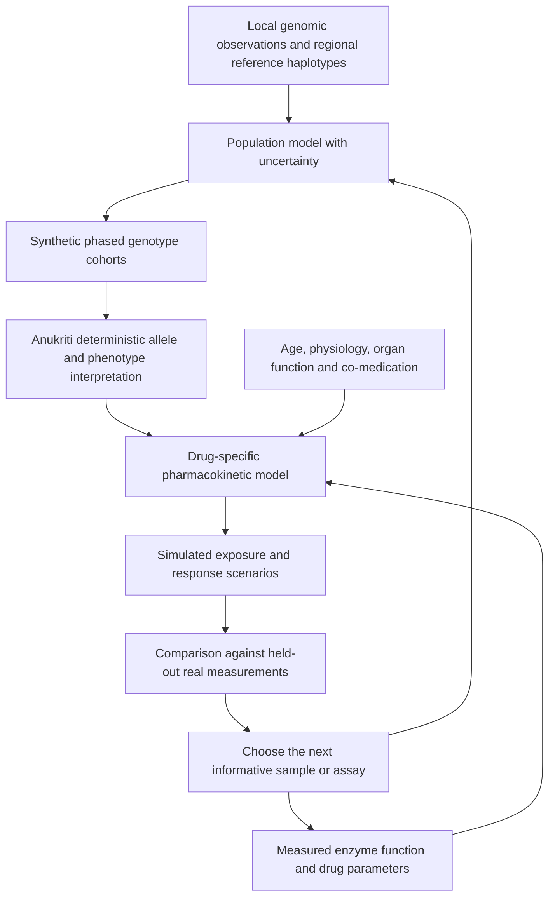

**Yes: we can computationally generate additional human genomes, and there is a practical route to useful PGx synthetic data.** My earlier response gave too much space to the limits and too little to the engineering route. This follow-up adds stronger research evidence, a working regional generator, and a real held-out benchmark.

Research date: 6 September 2026. Literature results, our measured results, and proposed future work are distinguished below. “Synthetic genomes” can mean whole-genome variant profiles, regional genotypes, or complete nucleotide sequences; those are different outputs.

**What is already demonstrated in the literature**

| Method | Demonstrated capability | Relevance to Anukriti |
|---|---|---|
| HAPNEST, 2023 | Released 1,008,000 synthetic individuals with 6.8 million common variants and nine simulated traits | Strong evidence that generating biobank-scale genome-wide genotype cohorts is feasible |
| Ped-sim, 2019 | Pedigree simulation with sex-specific recombination maps and crossover interference | A mature implementation close to the proposed computational-parent/child mechanism |
| Haptools | Simulates admixed genotypes across specified generations using phased references and genetic maps | Useful for constructing ancestry-segment mosaics and recording their origins |
| SimHumanity, 2025 | SLiM 5 models spanning autosomes, sex chromosomes, and mitochondrial inheritance under evolutionary scenarios | Supports the multigeneration version, including demographic assumptions |
| HAP-SAMPLE2, 2025 | Simulates genotype/phenotype datasets with admixture and common/rare-variant scenarios | Useful for controlled experiments where effects and prevalence are specified |
| SNPgen, March 2026 preprint | Phenotype-conditioned latent diffusion evaluated with training on synthetic data and testing on real data | Evidence for downstream utility, but presently on selected SNP panels and largely one ancestry |

The sources are [HAPNEST](https://academic.oup.com/bioinformatics/article/39/9/btad535/7255913), [Ped-sim](https://pmc.ncbi.nlm.nih.gov/articles/PMC6944377/), [Haptools documentation](https://haptools.readthedocs.io/en/stable/commands/simgenotype.html), [SimHumanity](https://www.pivotscipub.com/hpgg/5/4/0006/html), [HAP-SAMPLE2](https://academic.oup.com/bioinformatics/article/41/6/btaf333/8161565), and the [SNPgen preprint](https://arxiv.org/html/2603.10873v1).

These tools provide several routes. HAPNEST supports large common-variant datasets; a forward simulator addresses inheritance and demographic history; a conditional generative model can address a defined prediction task. HAP-SAMPLE2's rare-variant scenario generator should not be mistaken for discovery of actual unobserved variants in a country.

SNPgen is promising but needs a precise reading. It used UK Biobank data from up to 458,724 participants and generated trait-specific panels of 1,024–2,048 SNPs. Reported synthetic-data-trained nonlinear models approached real-data-trained performance for several traits. It also reported weaker results for some model/trait combinations, including breast-cancer linear risk scores. This is a preprint using a large existing cohort, not evidence that a tiny seed cohort automatically yields equivalent clinical labels. [SNPgen methods, results, and limitations](https://arxiv.org/html/2603.10873v1).

**The parent → child idea is implementable**

Take two phased homologues from each parent. Generate a maternal gamete and paternal gamete using recombination maps, combine them into a diploid child, record the pedigree, and repeat. The basic mechanism follows meiotic inheritance: crossing over exchanges segments between homologous chromosomes when egg and sperm cells form. [NHGRI explanation](https://www.genome.gov/genetics-glossary/Crossing-Over).

For realistic family simulations, use established sex-specific maps and crossover-interference models. For a country-sized virtual population, start from a diverse founder panel and an explicit demographic model. Simulating repeated descendants of just two people creates a family; that is useful for inheritance studies but is a poor founder design for representing a population. Ped-sim and SimHumanity already provide much of this machinery. Their generated populations are conditional on supplied founders, maps, and demographic assumptions, not observations of a future country.

“Maturing into an adult” is a separate modeling layer. For ordinary germline PGx, the inherited genotype is the starting state. Adult age, body size, organ function, enzyme expression, comorbidities, and co-medication determine the physiological context. We can attach these states to synthetic genotypes without simulating every cell from conception. PK-Sim already provides virtual-population machinery using age/body-size relationships and, where available, enzyme ontogeny. [PK-Sim population documentation](https://docs.open-systems-pharmacology.org/v12/working-with-pk-sim/pk-sim-documentation/pk-sim-creating-populations).

**What I actually built and measured in this workspace**

The new prototype is in [anukriti/research/synthetic_genomes](../benchmark/README.md). It includes a two-parent meiosis function and a separate reference-based population generator. The generated cohort uses the latter.

It extracted 8,901 complete phased biallelic SNVs around CYP2B6 from the existing real 1000 Genomes chromosome-19 VCF. The source contains 2,504 participants. For each of four target populations, it used 20 local participants, a larger regional donor panel excluding that population, and held out all remaining target participants. It compared six methods over three fixed splits per population: 72 benchmark runs in total. Hyperparameters were fixed before inspecting the benchmark.

It also produced **5,000 synthetic diploid regional profiles**, each containing 8,901 sites. Every exported genotype, allele, phase, position, and sample ID passed exact round-trip verification. The VCF is approximately 2.2 MB compressed. It represents an approximately 250 kb region, not full human genomes, and uses a Bengali reference proxy rather than Bhutanese participants.

| Generator | Mean common-SNP frequency error | Mean LD r² error |
|---|---:|---:|
| Independent variant sampling | 0.04297 | 0.07590 |
| Copying only the 20 local participants' haplotypes | 0.04239 | 0.04616 |
| Copying regional reference haplotypes | 0.02444 | 0.02146 |
| Copying pooled local + regional haplotypes | **0.02399** | **0.02119** |
| Locally calibrated pooled copying | 0.03028 | 0.02441 |
| Locally calibrated block mosaics | 0.03128 | 0.03342 |

Lower is better. Frequency error 0.02399 means an average error of about 2.4 percentage points across training-common variants. It is not a clinical accuracy percentage. These are averages over four proxies and three overlapping participant splits, not independent external replications.

The useful findings are concrete:

1. Synthetic genotypes can preserve measured population structure substantially better than independent SNP sampling.
2. Pooling local and regional donors reduced frequency error by 43.4% relative to local-only resampling in this experiment. The benefit comes from using additional real reference information.
3. Mosaic generation created regional haplotype combinations absent from the pooled founders, while every protected CYP2B6-region block matched a founder at the retained sites. It also introduced LD distortion.
4. My proposed calibration did **not** outperform simple pooling overall. It improved the selected CYP2B6 marker for the CHB proxy, but the broad average favored simpler pooling. We should carry forward that baseline.

The full [benchmark report](../benchmark/results/REPORT.md) gives every population/method comparison. [Metrics and full splits](../benchmark/results/metrics.json), [generated VCF](../benchmark/results/synthetic_beb_proxy_chr19.vcf.gz), and [export manifest](../benchmark/results/export_manifest.json) are available locally.

This experiment also found a real input gap: the source region contains rs3745274 but lacks rs2279343 at its verified GRCh37 coordinate. The generated VCF records that omission. It cannot establish complete CYP2B6 star-allele correctness. Protecting a block at retained SNVs does not reconstruct missing sequence, indels, or structural variants. The coordinate checks used [NCBI rs3745274 records](https://www.ncbi.nlm.nih.gov/clinvar/RCV000022520.27/) and [NCBI rs2279343 records](https://www.ncbi.nlm.nih.gov/clinvar/RCV000106294/).

**How to turn generated genomes into useful PGx data**

The pipeline I recommend developing is:

This is a proposed architecture, not an implemented or clinically validated pipeline. The current prototype covers generation and regional genotype evaluation only.

The components have different sources of evidence:

- **Population genetics:** local observations determine how much regional haplotypes should contribute. Model subpopulations explicitly rather than treating a national border as one ancestry. Generate an ensemble of plausible cohorts to propagate uncertainty in frequencies and relatedness.
- **Known PGx interpretation:** keep the pinned deterministic Anukriti core as the interpretation authority. Missing assay coverage and unknown variants must remain explicit. Its existing tables must not be silently replaced with synthetic model outputs.
- **Variant function:** use experimentally measured enzyme activity where available; keep computational predictions as uncertain evidence until their relevant performance is demonstrated.
- **Drug exposure:** pass genotype-related enzyme parameters and physiological covariates into a drug-specific model. Label its outputs as simulations, retaining assumptions and parameter uncertainty.
- **Clinical learning:** train with simulated data only after defining a real held-out endpoint and testing whether synthetic augmentation improves it over real-data-only and reference-transfer baselines.

There is stronger evidence for the function layer than a purely statistical generator would provide. A CYP2C9 study measured activity for **6,142 missense variants** and abundance for **6,370 variants**. That creates experimental molecular information across many possible variants without requiring an equally large cohort of patients carrying them. A separate CYP2C19 study measured variant abundance in human cells. These assays are especially useful for selecting variants for follow-up, but abundance alone is not enzyme activity, and an assay substrate is not every drug. [CYP2C9 study](https://pubmed.ncbi.nlm.nih.gov/34314704/), [CYP2C19 study](https://pubmed.ncbi.nlm.nih.gov/39319420/).

The drug-model layer is also concrete. A published PK-Sim clopidogrel model used 66 concentration-time profiles and included CYP2C19 metabolizer groups; 17/19 drug–gene AUC ratios and 19/19 peak-concentration ratios were within twofold of observed ratios. Its source models are available. This is a useful starting benchmark, not a Bhutan validation or a guarantee that simulated clinical outcomes are correct. [Model paper](https://pubmed.ncbi.nlm.nih.gov/35631502/), [model repository](https://github.com/Open-Systems-Pharmacology/Clopidogrel-Model).

The key opportunity is to combine population observations, molecular experiments, and physiological models. That combination can support many more useful scenarios than population genotypes alone. It still requires checking each intended endpoint against real measurements.

**A concrete Bhutan pilot**

Bhutan has published PGx observations already: one study genotyped 443 DNA samples for a limited set of variants in CYP2C9, CYP2C19, CYP2D6, and CYP3A5. These are candidate calibration observations, subject to representativeness and data-access checks; they are not a complete national genome panel. [Bhutan study](https://pubmed.ncbi.nlm.nih.gov/32004143/).

My proposed first pilot would focus on CYP2C19/clopidogrel, conditional on clinical partners confirming that this is a locally useful question. It offers a connection between published Bhutanese marker data and existing mechanistic models. This choice is a research recommendation, not prescribing advice.

1. Audit existing local data, assay coverage, recruitment, subgroup representation, and availability of paired clinical measurements. Set collection size using the endpoint and precision required; the 20-person prototype is not a recommended clinical cohort size.
2. Build a high-quality phased donor panel. Include local participants, scientifically justified regional references, and assay-specific structural-variant handling. Do not label generic South or East Asian genomes as Bhutanese.
3. Benchmark existing map-based generators against simple pooled copying. Partition real people and families before fitting; tune only within training/validation partitions. Preserve a final untouched local test cohort.
4. Generate realistic cohorts for population frequency/exposure estimates and separately generate deliberately enriched rare scenarios for testing. Enriched scenarios need explicit weights; their raw counts cannot estimate population prevalence.
5. Apply the established PGx interpretation and a reproduced drug model. Include model discrepancy and uncertainty when producing virtual exposure labels.
6. Compare simulations to genotype-stratified real concentrations or a clearly defined drug-response endpoint. Report calibration, subgroup error, rare-variant coverage, and decision performance—not just visually similar genomes.
7. Use the largest consequential uncertainties to choose the next local sample or functional assay. Update the model and evaluate on fresh held-out observations.

When local individual-level data are unavailable, published marker frequencies can constrain provisional synthetic scenario cohorts. They cannot uniquely identify joint haplotypes or national subgroup mixtures. Report alternative compatible scenarios until local phasing and validation data resolve them. This still permits useful assay planning and pipeline development immediately.

**The research contribution worth pursuing**

The most promising hypothesis is **PGx-task-directed synthesis with adaptive reference borrowing**: choose donor weights and synthetic scenarios according to a drug-relevant uncertainty, rather than maximizing the number of generated people or matching every SNP equally.

The prototype gives a reason to investigate this: global calibration hurt average fidelity, while calibration helped one population/marker comparison. A next method could learn when to trust local evidence, regional evidence, or a broad uncertainty interval at each pharmacogene, using separate populations and loci for development. It could then prioritize genotype–physiology combinations where plausible models disagree on a clinically consequential outcome.

This combination might become a useful research contribution, but I have not established novelty or shown that it improves clinical performance. The next publishable test would compare it with HAPNEST/Haptools-style generation, simple pooled sampling, real-only learning, and reference-transfer baselines on genuinely held-out local endpoints. Synthetic sample size should be varied to identify saturation; uncertainty must remain linked to the real and experimental evidence supporting the generator.

For Anukriti, the immediate result is a reproducible generator, a checked synthetic regional dataset, and evidence favoring a simple baseline. The next substantial target is a population-calibrated, drug-specific virtual cohort whose usefulness is measured on real local observations.
