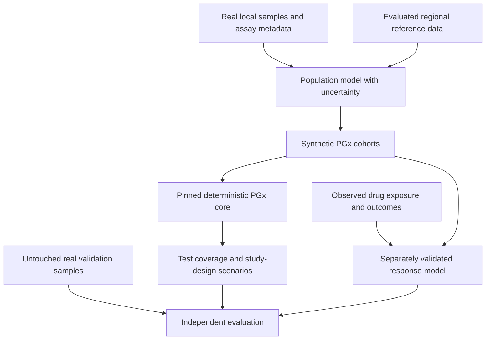

# Synthetic genomes for populations with limited PGx data

Research date: 6 September 2026. Prepared for Anukriti following a discussion about Bhutan and other small countries. This is a research assessment and proposed experimental programme, not a clinically validated model or a record of experiments already performed.

## Assessment

Computational inheritance is feasible. We can generate possible offspring from phased parental genomes, propagate their descendants through generations, and simulate population history. These methods can create useful synthetic cohorts for testing software, studying inheritance, exploring demographic assumptions, and evaluating research designs.

The inference limit is equally important: descendants generated from a small set of founders do not constitute new observations of the country's population. A simulator cannot establish the existence, local frequency, or clinical effect of variants for which it has no relevant evidence. It can introduce hypothetical mutations and outcomes, but their apparent properties come from the model's assumptions.

My recommendation is to investigate **population-calibrated PGx simulation using a shared deterministic engine, real local observations, and explicitly uncertain reference-data borrowing**. Start with a small number of gene–drug questions. The first objective should be demonstrating better estimates or better study decisions on real held-out data, rather than generating the largest number of genomes.

## 1. Bhutan has a starting evidence base

A study published in December 2019 genotyped 443 Bhutanese DNA samples for selected CYP2C9, CYP2C19, CYP2D6, and CYP3A5 variants. It reported CYP2C19 `*2` and `*3` allele frequencies of approximately 30.1% and 15.7%. These are findings from that sample and assay, not a complete national reference panel or drug-outcome study. I accessed the indexed abstract; sampling details and assay validation require the full paper before reuse. [Dorji et al., primary study](https://pubmed.ncbi.nlm.nih.gov/32004143/).

A 2025 study generated 87 high-coverage whole genomes across 16 Himalayan populations, including six populations from Bhutan. It found substantial regional population structure. The 87 is the total across countries, not a Bhutan-only sample size. [Arciero et al., Current Biology](https://doi.org/10.1016/j.cub.2025.06.048).

The paper identifies EGA datasets `EGAD00001004797` and `EGAD00001011358`. The latter's public catalogue has a request-access path; catalogue visibility is not permission to download or redistribute the underlying genomes. Participant coverage and allowed synthetic derivatives would need to be established with the data custodians. [EGA dataset](https://ega-archive.org/datasets/EGAD00001011358).

Bhutan's 13th Five Year Plan also includes genomic surveillance and biobanking capacity, with a non-communicable-disease activity focused on diabetes. This is a capacity-building plan, not evidence of an operational nationwide PGx service. [Bhutan Ministry of Health plan, PDF](https://moh.gov.bt/wp-content/uploads/2025/01/B5_13_FYP_Booklet.pdf).

Small national population is not an absolute barrier to useful genomic research. Iceland's 2015 study sequenced 2,636 people and imputed variants into 104,220 genotyped individuals. Those additional people were real participants with measurements; they were not invented descendants. Infrastructure, access, sampling, and phenotype collection remain substantial requirements. [Gudbjartsson et al., Nature Genetics](https://www.nature.com/articles/ng.3247).

The precise problem therefore needs to be named: missing local genomes, missing specific alleles, weak assay coverage, insufficient outcome data, inaccessible data, or limited implementation capacity. Synthetic data helps these problems to very different degrees.

## 2. A country need not train a new engine for every established PGx relationship

CPIC publishes guidance on using available genetic test results, including genotype-to-phenotype interpretation and prescribing recommendations. This provides a shared knowledge base rather than a requirement to relearn each relationship separately in every country. Population-specific coverage and applicability still need assessment. [CPIC guideline scope](https://cpicpgx.org/%20guidelines/).

For this project, keep three questions separate:

| Question | Necessary evidence | Role for synthetic data |
|---|---|---|
| What does this patient's observed genotype imply under an established rule? | Adequate assay, correct allele interpretation, applicable guideline, clinical context. | Test the implementation and difficult input combinations. |
| How common are relevant genotypes in the target population? | Representative local sampling, appropriate reference data, uncertainty about structure and sampling. | Integrate and propagate an estimated distribution; explore scenarios. |
| What benefit or adverse event will occur after a particular treatment? | Drug exposure and outcomes, dose, disease, physiology, co-medication, and validated causal/predictive assumptions. | Support a validated response model; cannot create independently observed labels. |

The country where a medicine is manufactured does not answer these questions. A geographic label also should not substitute for an individual's genotype or silently determine allele function.

## 3. What the proposed parent-to-child simulator would do

For a defined pedigree, phased founder chromosomes are the input. A meiosis model transmits mosaics of each parent's two homologous chromosomes, using crossover locations rather than independently flipping a coin at every SNP. Ped-sim supports sex-specific recombination maps and crossover interference, and evaluates simulated inheritance against real relatives. [Caballero et al., Ped-sim](https://pmc.ncbi.nlm.nih.gov/articles/PMC6944377/).

Conceptually:

```text
Founders with phased genomes
    -> sampled meioses and inherited chromosome segments
    -> descendant genotypes
    -> additional generations under stated mating/demographic assumptions
```

For a simple biallelic locus, `Aa × Aa` produces probabilities of 25% `AA`, 50% `Aa`, and 25% `aa`. Generating a million offspring estimates those stipulated probabilities more precisely. It does not tell us how common `a` is in Bhutan.

At an ordinary autosomal locus, two diploid founders supply four original chromosome copies. Crossover reshuffles existing material. A new combination can be informative for testing a mechanism, but it does not supply the missing diversity of unrelated families. Mutation or migration can expand the simulated variant set only through additional model assumptions or external data.

A closed population descended from one couple also has extreme relatedness. Repeated generations add drift, mating assumptions, and selection effects. They simulate descendants of those founders, not automatically the contemporary national population. If the target is present-day PGx prevalence, repeated reproduction may be unnecessary and may make the cohort less representative.

Do not enumerate every theoretical child or remove merely inconvenient outcomes. Sample probability-weighted outcomes and retain the assumptions. Excluding genotypes without a defensible survival model creates selection bias. Physical phase, linked variants, missing calls, structural changes, sex chromosomes, and mitochondrial inheritance require explicit handling appropriate to the chosen simulator.

## 4. Relevant methods and direct prior work

| Method | Most useful role here | Important constraint |
|---|---|---|
| Pedigree simulation / gene dropping | Family inheritance, segregation, relatedness, and caller testing. | Founder genomes and a pedigree determine the available evidence. |
| Haplotype resampling / copying models | Generate additional draws resembling a reference panel. | Accuracy depends on matching reference haplotypes and population structure. |
| Coalescent simulation | Efficient demographic and ancestry-model experiments. | An assumed history can reproduce population statistics without reconstructing the actual target's named variants. |
| Forward population simulation | Explicit mating, drift, selection, migration, and multiple generations. | More biological processes mean more parameters requiring calibration. |
| Learned genome generators | Data sharing, conditional augmentation, learning genomic correlations. | Missing populations, rare variants, privacy, and task-specific validity remain difficult. |
| Mechanistic drug-response models | Simulate exposure for a defined drug and physiological scenario. | Requires a separately calibrated pharmacological model and real validation. |

**HAPGEN2.** Resamples known haplotypes to create datasets with realistic local linkage patterns and specified disease models. Useful as an interpretable baseline; simulated disease effects are inputs to the experiment. [Su et al., 2011](https://pubmed.ncbi.nlm.nih.gov/21653516/).

**msprime / tskit.** Efficient ancestry and mutation simulation supports large demographic experiments. Its documentation also provides a fixed-pedigree mode. It is a population-genetics simulator, not a drug-response model. [msprime 1.0 paper](https://pmc.ncbi.nlm.nih.gov/articles/PMC9176297/), [official ancestry documentation](https://tskit.dev/msprime/docs/stable/ancestry.html).

**SLiM / SimHumanity.** SimHumanity, published in October 2025, provides reusable SLiM 5 models for evolution of the full human genome, including sex chromosomes and mitochondrial DNA. This closely matches the proposed multi-generation component. Its outputs are simulated evolutionary histories, not mature human physiology. [SimHumanity paper](https://www.pivotscipub.com/hpgg/5/4/0006). The official project lists SLiM 5.2 as released in April 2026. [SLiM project](https://messerlab.org/slim/).

**GANs and restricted Boltzmann machines.** Yelmen et al. demonstrated artificial genomes and some downstream utility in 2021. Their experiments also exposed rare-allele loss and imperfect linkage structure; broadly similar genomic distributions did not imply fidelity for every variant. [Primary PLOS Genetics paper](https://journals.plos.org/plosgenetics/article?id=10.1371/journal.pgen.1009303).

**Diffusion models.** A July 2025 study generated millions-of-site genotype/haplotype profiles and reported classification benefits from synthetic augmentation. Its data included a substantial Dutch ALS cohort and 1000 Genomes; the result does not establish recovery of an unseen Bhutanese treatment-response distribution from a few founders. [Kenneweg et al., primary paper](https://academic.oup.com/bioinformatics/article/41/Supplement_1/i484/8199400).

**Genomator.** The 2025 paper includes a direct PGx demonstration: synthetic chromosomes preserving frequencies of three variants in CYP2C19 and VKORC1. Its default privacy settings suppress some low-frequency variants. That makes it useful prior work to benchmark, with an important PGx limitation. [Burgess et al., primary paper, section 3.5](https://academic.oup.com/bioinformatics/article/41/12/btaf600/8314204).

My interpretation: preserving observed variant frequencies is a useful engineering result, but it does not establish unseen population-specific biology or treatment outcomes. Also, an allele combination absent from a small training sample can still be biologically possible. An algorithm's rule against unobserved combinations must not become an assertion about human viability.

The general idea of creating synthetic human genetic cohorts is therefore established prior work. A potentially valuable Anukriti contribution would be rigorous **PGx-specific validation under limited local data**, including uncertainty, missing variants, complex alleles, and better decisions about what to measure next.

## 5. The statistical information limit

Let the observed real data be `D`, external knowledge be `K`, and independent simulation randomness be `U`. A synthetic dataset is generated as `S = G(D, K, U)`. Conditional on `D` and `K`, its random draws do not observe the target population again.

Simulation can still improve a practical model by imposing useful structure, regularizing an unstable estimator, transferring external information, or providing more numerical draws from a fitted distribution. Those are real benefits. They should not be described as obtaining new independent patients from the same few observations.

Two kinds of uncertainty must remain separate:

- **Monte Carlo uncertainty:** how accurately a finite synthetic cohort represents the model you specified. More generated records can reduce it.
- **Uncertainty about reality:** whether the founders, allele frequencies, population structure, and response model describe the target population correctly. More generated records alone do not remove it.

### Illustration: an allele missing from the founders

For an autosomal allele with true frequency `p`, the probability of observing no copies in `N` unrelated diploid people is approximately:

`P(miss) = (1 - p)^(2N)`

This assumes random sampling, independent chromosome copies under the simple model, and error-free detection. Real relatedness, substructure, and assay failures can invalidate the approximation.

| Real donors | Chance of missing an allele with frequency 0.1% |
|---:|---:|
| 100 | 81.9% |
| 300 | 54.9% |
| 500 | 36.8% |
| 1,000 | 13.5% |
| 1,500 | 5.0% |

These are illustrative calculations, not Bhutan estimates. Resampling a founder panel that missed the allele cannot recover it through ordinary inheritance. Adding a hypothetical mutation is not an observation that it occurs locally.

Under the same assumptions, a 95% chance of seeing at least one copy requires about 150 people for a 1%-frequency allele and 1,498 people for a 0.1%-frequency allele. **Seeing one copy is not enough to estimate its frequency precisely or establish its treatment effect.** These are not recommended clinical-study sample sizes.

### Illustration: precision does not follow the synthetic row count

Suppose 100 real people provide 200 assayed chromosome copies and two carry the allele. The observed frequency is 1%; a simple 95% Wilson interval is approximately **0.27%–3.57%**. Generating a million synthetic people at the fitted 1% frequency does not shrink the original sampling uncertainty to the interval expected from a million independently measured people.

### Correct uncertainty propagation

A proposed Bayesian implementation would draw plausible local frequencies/structure from their posterior, then generate a cohort under each draw, then apply the fixed PGx engine. Variation between these simulations captures uncertainty in the fitted population model. Keep reference-data borrowing explicit and test sensitivity to priors; an overly confident borrowed prior can give precise but wrong results.

For outcome prediction, genotype data can inform `P(genotype | population)`. Treatment outcomes require an additional quantity such as `P(outcome | genotype, drug, dose, physiology, context)`. A realistic first distribution does not identify the second.

## 6. “Maturing the baby” needs a different model

You do not need to grow a simulated person to generate their inherited PGx genotype. To model adult response, the missing layer is physiology and pharmacology: age, body size, organ function, enzyme activity, co-medication, disease, dose, and exposure–response relationships.

Physiologically based pharmacokinetic (PBPK) models already combine drug, physiology, and population characteristics. FDA describes their potential use and assesses whether they can substitute for particular clinical PK data case by case. That is support for specific qualified models, not general approval of synthetic patient outcomes. [FDA PBPK guidance](https://www.fda.gov/regulatory-information/search-fda-guidance-documents/physiologically-based-pharmacokinetic-analyses-format-and-content-guidance-industry).

A concrete example used 102 human liver samples and PK-Sim to study CES1 genotype, sex, and interaction effects on methylphenidate exposure. The experimental and clinical information is precisely what a genome generator alone lacks. [Primary PBPK study](https://pubmed.ncbi.nlm.nih.gov/35526575/).

Advanced sequence models do not close this gap. Evo 2 demonstrates sequence modeling/design and variant-effect applications. AlphaGenome predicts molecular regulatory effects, while its paper explicitly limits complex-trait interpretation and notes that personal-genome prediction was not benchmarked. Neither cited work validates genome-to-adult-to-drug-outcome simulation for Bhutan. [Evo 2](https://www.nature.com/articles/s41586-026-10176-5), [AlphaGenome](https://www.nature.com/articles/s41586-025-10014-0).

For Anukriti, drug-specific PBPK could be a later research layer after selecting a tractable drug and assembling observed exposure data. Preserve the distinction between predicted concentration, guideline-derived phenotype/action, and an observed adverse event.

## 7. Anukriti implementation proposal

This section is my proposed design, not a claim that the repositories already implement it.

### Start with the question and local data

Work with Bhutanese clinical/research partners to choose one or two drug–gene use cases based on actual prescribing, clinical burden, available assays, and accessible outcome data. CYP2C19 is an evidence-backed candidate for an initial methods exercise because of the existing Bhutan study and current Anukriti caller; that is not a recommendation to make it the national clinical priority without local input.

Inventory the existing samples and publications before commissioning a new sequencing programme. Establish which subpopulations and relatives are represented, what loci were actually assayed, the genome build/strand conventions, and whether linked clinical data and reuse permissions exist. A four-gene frequency abstract cannot be treated as phased whole-genome data.

### Compare simpler methods before training a large generator

Use a preregistered comparison of:

1. Local observed counts, with sampling uncertainty.
2. An external-reference baseline without synthetic augmentation.
3. A hierarchical model that borrows external information while allowing local differences.
4. Haplotype-aware resampling from available founders/reference panels.
5. Pedigree or forward simulation when inheritance/demography is part of the question.
6. Genomator or diffusion augmentation if the available dataset and target task justify it.

A synthetic method needs to beat the relevant statistical baseline on the chosen decision, or provide another measured benefit such as shareability. Generating visually convincing PCA clusters is insufficient. External reference panels should be selected and evaluated from genetic/data evidence; neither “India” nor “East Asia” is automatically a calibrated Bhutan substitute.

### Simulate the necessary genetic scope

For frequency or test-panel planning, begin with well-defined PGx loci/haplotypes. Do not generate all three billion reference positions merely to count a handful of known alleles. Whole-genome structure becomes relevant when evaluating ancestry, imputation, genome-wide associations, relatedness, or discovery.

Preserve phased multi-site alleles when available, and keep uncertain phase uncertain. Model structural changes separately where necessary. A common-SNP generator's good metrics do not establish support for CYP2D6 copy number/hybrids, HLA resolution, or rare indels. Maintain explicit assay coverage and unresolved results; simulated absence must not become evidence of a negative assay.

### Reuse the actual shared core

Use `anukriti-pgx-core` as the fixed rule interpreter and retain exact version pins. CohortFit's population arithmetic and Swarm's source/provenance handling are useful existing concepts, but the current workspace has no calibrated Bhutan generator. Avoid using browser-local `pgxRules.js` as a second clinical ground truth. The original local workspace context file, `.anukriti-context-refresh-2026-09-06.md`, records these ownership boundaries; the current docs collection describes them in the [implementation plan](../IMPLEMENTATION_PLAN.md#repository-integration).

Suggested provenance fields include `record_origin`, `real_donor_count`, `synthetic_record_count`, `reference_population`, `sampling_design`, `genome_build`, `assay_scope`, `phasing_method`, `generator_version`, `founder_partition`, `parameter_draw`, and `core_version`. Label predicted outcomes separately from observed outcomes. Synthetic rows must not enter the real-patient denominator or the institutional outcome ledger as patients.



### Aim for a useful first output

The initial research report could answer: which existing test panel covers the most relevant observed variation; how sensitive that estimate is to unknown frequencies or missing subpopulations; which extra assay targets are worth studying; and which new samples would most reduce decision uncertainty.

Use simulated outcome scenarios only when clearly conditional on stated assumptions. Do not attach a claim of adverse-event reduction to allele-frequency fidelity alone. A novel variant can be prioritized for functional or clinical research without being assigned a new prescribing action.

## 8. Experiments that would establish whether the idea works

These are proposed future experiments. This research pass reviewed literature and calculated simple sampling examples; it did not train a generator or establish clinical benefit.

**A. Controlled scarcity benchmark.** Take a population with sufficient real data, hide most of it, and run learning curves with successively smaller training samples. Test whether augmentation improves prediction on the hidden real participants. Repeat across populations, founder draws, and independent seeds. This is a methods test, not Bhutan validation.

**B. Reference-mismatch experiment.** Hide the target population entirely, then add a small local anchor sample. Measure whether regional borrowing helps or causes negative transfer. Compare the generator against the same reference information supplied directly to a hierarchical/statistical method.

**C. Rare-variant challenge.** Withhold specific observed rare alleles, linked allele definitions, and structural variants from training. Measure detection limits, false invented combinations, and whether the method honestly preserves uncertainty. A method should not claim that a deliberately unobserved local allele has been rediscovered merely because it can randomly synthesize it.

**D. Clinical-label experiment.** If actual treatment outcomes are available, compare real-only, reference-assisted, and synthetic-augmented models on future/site-separated real outcomes. Check calibration and clinically consequential errors. Labels generated by the same CPIC engine can test rule agreement, but they cannot independently validate that engine or demonstrate treatment benefit.

**E. Privacy/utility evaluation.** Evaluate whether outputs disclose individuals or relatives and whether privacy settings erase clinically relevant variants. PRISM-G, published in August 2026, measures complementary proximity, relatedness, and trait-linked risks; it is an evaluation framework, not a blanket guarantee of anonymity. [Primary PRISM-G paper](https://academic.oup.com/bioinformatics/article/42/Supplement_2/btag377/8767287).

Split real data **before** fitting the generator, phasing/imputation components where relevant, or selecting hyperparameters. Keep close relatives/founder-derived descendants within the same partition. Randomly splitting synthetic siblings across train and test creates misleading validation. Retain an untouched real test set and assess uncertainty using the actual independent sampling units.

Measure PGx-specific outcomes: allele/diplotype frequency error, function/action class error, rare-variant sensitivity, false-normal calls, unresolved-call rates, panel coverage, interval calibration, and any actual exposure/outcome performance. Also inspect LD, population structure, haplotype validity, and kinship; these are supporting checks rather than substitutes for task validation.

## 9. What a defensible claim would look like

Evidence could justify statements such as:

- “This simulated cohort reproduces specified PGx statistics of the held-out real reference population within the reported error.”
- “Under the stated population model, panel A has better estimated coverage than panel B, with these uncertainty intervals.”
- “Synthetic augmentation improved a particular predictor on independent real patients compared with the prespecified baselines.”
- “The analysis identified which additional local samples would most reduce uncertainty.”

The current research does not justify saying that two genomes can replace a national biobank, that synthetic descendants add independent patients, that all novel drug responses can be inferred from DNA, or that a country-specific model is clinically validated without appropriate real observations.

The strongest project hypothesis is: **a limited but well-characterized local dataset, combined with transferable biological knowledge and rigorously validated simulation, can improve PGx planning and evidence collection in underrepresented populations.** The value has to be measured in decisions, coverage, calibration, or real predictive performance—not the number of synthetic genomes produced.

## Research boundaries and open questions

The literature reviewed includes primary method papers, Bhutan/Himalayan studies, official software documentation, a primary data catalogue, and official guidance. Publication dates were checked through September 6, 2026. The direct Bhutan PGx paper was available through its abstract; national representativeness and reuse conditions are unresolved. No controlled-access data were requested or downloaded, no partner was contacted, and no project code or clinical rule was changed.

For a concrete Bhutan collaboration, the unresolved inputs are the intended decision, available samples and assays, subpopulation/relatedness structure, usable treatment records, local research governance, and which institution could perform independent validation. The appropriate study size follows those inputs; country population size alone does not determine it.
